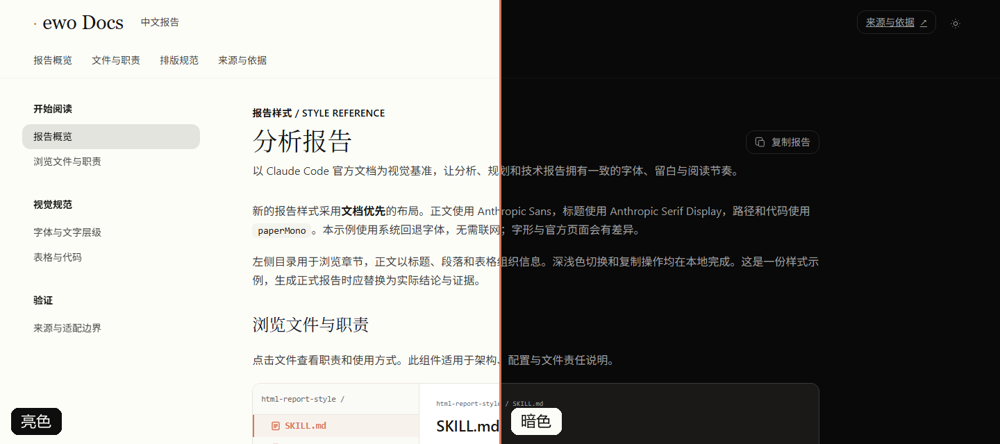
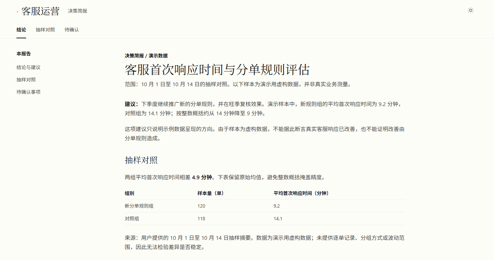

# html-report-style

让 Agent 把分析、方案和评审结论做成一份中文 HTML 报告：单文件，离线能打开，排版参照 Claude Code 官方中文文档。

<p align="center">
  
</p>

## 实际效果



上图是 `python scripts/create_report.py --output report.html --title "分析报告" --system-fonts` 生成的文件，在 Chrome 里截图：左半是亮色，右半是点击页头切换按钮后的暗色，同一份文件、同一滚动位置。正文是模板自带的示范内容，不是真实分析。Agent 按一句话要求做出的报告见「第一次使用」。

## 状态与限制

- **能用在哪**：会加载 Agent 技能（`SKILL.md`）的 Agent。已实测 Codex（0.157.1，Windows 11）：技能放在项目内的 `.agents/skills/`，Codex 按名字加载并完成一次生成，见「第一次使用」。用户级目录 `~/.agents/skills/` 和 Claude Code 的 `~/.claude/skills/` 没有按下面的命令重新装一遍〔待核〕；Claude Code 的技能列表里已出现过本技能的旧版。
- **范围和字体**：不适合普通问答（直接在对话里回答，不生成文件）、完整 Web 应用、讲解视频（只出静态解释稿和分镜清单）。仓库不带官方字体，默认用系统字体，字形与官方页面有差异；要匹配得自备你有权使用的字体文件。
- **依赖**：Python 3.9+。在 3.12 和 3.13 上运行过；脚本按 3.9 语法解析通过，没有在 3.9 解释器上运行过〔待核〕。生成报告不需要第三方包；画科研图要 matplotlib，渲染 Mermaid 要 Node.js 和 mermaid-cli，两者都可选。
- **读写哪些文件、联不联网**：脚本只读技能目录和你指定的字体、图形文件，只写 `--output` 指定的新文件，已存在就拒绝覆盖；不联网，不要凭据。仓库自带测试检查生成的报告不加载外部资源。Agent 读你给的材料时，内容会进入你所用模型的上下文。
- **维护与许可**：个人项目，没有发布 release；独立社区技能，与 Anthropic 官方无隶属关系。许可证 MIT。

## 安装

前置条件：Git、Python 3。

**推荐**：把这句话发给你的 Agent，它会按 [`docs/install.md`](./docs/install.md) 装到正确的位置。

```text
帮我安装 html-report-style：https://raw.githubusercontent.com/RZX00/html-report-style/main/docs/install.md
```

手动安装，一条命令：

| Agent | 命令 |
|---|---|
| Claude Code | `git clone https://github.com/RZX00/html-report-style.git ~/.claude/skills/html-report-style` |
| Codex 等读取 `~/.agents/skills/` 的 Agent | `git clone https://github.com/RZX00/html-report-style.git ~/.agents/skills/html-report-style` |

目标目录已存在时，先看里面有什么，不要覆盖你的修改。装完开一个新会话。

## 第一次使用

装好后对 Agent 说，点名技能，把「结论」「依据」换成你自己的：

```text
用 html-report-style，把下面的结论做成一份报告，保存为 ./report.html。
结论：客服首次响应时间从 14 分钟降到 9 分钟，建议下季度继续推广新的分单规则。
依据：10 月 1 日至 10 月 14 日抽样 120 单，平均 9.2 分钟；对照组 118 单，平均 14.1 分钟（样本为演示用的虚构数据）。
待确认：旺季是否仍有效。
```

你会得到 `./report.html`：一份决策稿，首屏是建议和适用范围，接着是两组均值的表格，最后是「待确认事项」。下图是 Codex 收到这段话后的实际产出，输入是上面的虚构数据。



这次运行：Codex 0.157.1，模型 gpt-6-sol，推理强度 low，只跑了一次，不能说明稳定性。Codex 先运行 `create_report.py --system-fonts` 得到骨架，再把示例正文换成这份结论，并去掉了与这份简报无关的示例组件（文件浏览器、代码块）。页脚注明用了系统字体。

不经过 Agent 直接运行脚本，得到的是上面「实际效果」里的模板示范报告：

```sh
python scripts/create_report.py --output output/report.html --title "分析报告" --system-fonts
```

命令最后打印输出文件的绝对路径，用浏览器打开即可。

## 什么时候用

按读者要做的事选形式，不是越复杂越好：

| 读者要做的事 | 形式 | 本技能怎么做 |
|---|---|---|
| 问一句、查状态、是非题 | 对话 | 不生成文件 |
| 评审、拍板、批准、回答问题、留档 | 决策稿（默认） | 首屏写结论、范围和待决定的事；证据不靠 JavaScript 也能读 |
| 理解一个机制、关系或变化 | 解释稿 | 决策稿之后加图和表；每张图写明问题、读法、来源和局限 |
| 读者得自己改输入才能得到答案 | 交互解释 | 只在表格列不完时加控件；先给静态结论和代表性结果 |
| 讲解视频 | 不在范围内 | 出静态解释稿、分镜清单和待核实的论断与来源 |

正文按 `SKILL.md` 的写法要求：一句话只说一件事，结论先行，术语首次出现时下定义，事实、推断和未知分开标。完整规则和反例见 [`references/output-ladder-and-prose.md`](./references/output-ladder-and-prose.md)。

## 能力与工作原理

**版式**取自对 Claude Code 官方中文文档页面的实测：亮色底 `#FDFDF7`、暗色底 `#090909`，正文 16px、行高 26.4px，标题 36 / 24 / 20px，桌面左侧目录 288px。实测值和来源见 [`references/claude-docs-visual-spec.md`](./references/claude-docs-visual-spec.md)。

**页面功能**：页头的深浅色切换（默认浅色，记住上次选择）、章节目录、代码块复制按钮、「复制报告」按钮、可选的文件详情组件。在 Chrome 里用 390px 宽的窗口测过：页面没有横向溢出，目录收成菜单。

**图形**按读者的问题选：精确比较用表格，小层级用 ASCII，流程和状态用 Mermaid 渲染成 SVG，架构和职责用带标注的 SVG，数据用科研图（折线、散点、柱状、箱线、热力图）。图在报告里可放大、缩小、拖动、适应窗口和下载；每张图要有标题、替代文字、说明和来源。选择方法见 [`references/visualization-guide.md`](./references/visualization-guide.md) 和 [`references/scientific-figures.md`](./references/scientific-figures.md)。

### 配置与命令

没有官方字体时，用系统字体生成：

```sh
python scripts/create_report.py --output output/report.html --title "分析报告" --system-fonts
```

要匹配原站字体，先在本地准备你有权使用的字体文件，再运行：

```sh
python scripts/create_report.py --output output/report.html --title "分析报告" --font-dir /path/to/fonts
```

字体文件名和原始公开来源见 [字体清单](./assets/fonts/manifest.json)。仓库不重新分发官方字体，也不含内嵌这些字体的示例报告；字体的使用、嵌入和分发遵循其权利人的条款，本仓库不授予第三方字体权利。内嵌字体的文件无需联网；系统字体模式下外观取决于本机字体。生成脚本不会覆盖已有输出文件。

<details>
<summary>图形与科研数据的命令</summary>

```sh
# 可选：科研绘图依赖
python -m pip install -r requirements-plot.txt
python scripts/plot_data.py examples/simulated.csv output/trend.svg --kind line --title "Simulated example" --xlabel "Step" --ylabel "Value" --source "Simulated teaching data, n=5" --error-label "Illustrative error magnitudes"

# 可选：Mermaid 构建依赖；报告运行时无需 Node 或网络
npm install -g @mermaid-js/mermaid-cli
python scripts/render_mermaid.py examples/flow.mmd output/flow.svg

# 将有来源和说明的 SVG/PNG 嵌入报告
python scripts/create_report.py --output output/visual-report.html --system-fonts --figures-json examples/figures.json
```

`--theme dark` 可为 Mermaid 和科研图生成深色版本，在清单里用 `dark_file` 指定。背景、文字和坐标轴随主题变，数据颜色和热力图色阶保持一致；下载跟随当前主题，打印用浅色版本。示例 CSV 是模拟数据，不代表任何产品测量结果。

</details>

### 测试

```sh
python -m unittest discover -s tests
```

4 项，在 Windows 11、Python 3.13 上通过，约 10 秒。其中画图用例需要 matplotlib。

## 文件结构

```text
SKILL.md                              报告生成与验证规则
agents/openai.yaml                    Codex 里的展示信息
references/
├── habitat-html-report-template.html 页面模板（文件名沿用历史命名）
├── claude-docs-visual-spec.md        实测样式、来源和适配差异
├── output-ladder-and-prose.md        输出选择与受控正文
├── visualization-guide.md            图形选择
└── scientific-figures.md             科研绘图规范
scripts/
├── create_report.py                  生成单文件报告
├── figure_embed.py                   把 SVG/PNG 嵌进报告
├── plot_data.py                      CSV 画科研图
└── render_mermaid.py                 Mermaid 渲染成 SVG
assets/                               字体清单、图形查看器、示例 SVG
examples/                             示例 CSV、Mermaid、图形清单
tests/                                4 项测试
docs/install.md                       给 Agent 读的安装说明
```

## 致谢

输出选择与受控正文的初版由 [shoa-lin](https://github.com/shoa-lin) 提交（[PR #2](https://github.com/RZX00/html-report-style/pull/2)）。

## 许可证

MIT，详见 [`LICENSE`](./LICENSE)。
